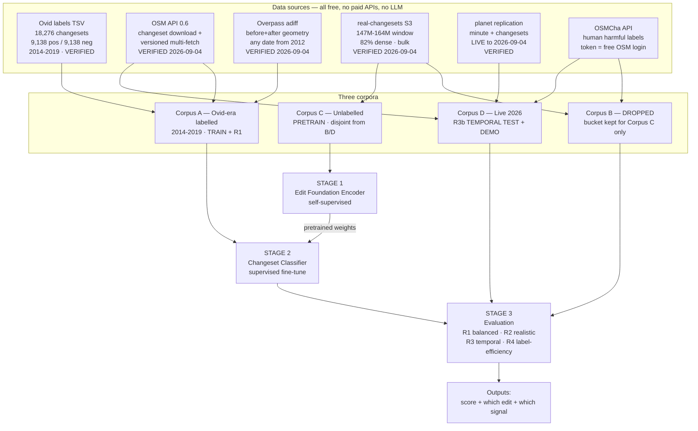
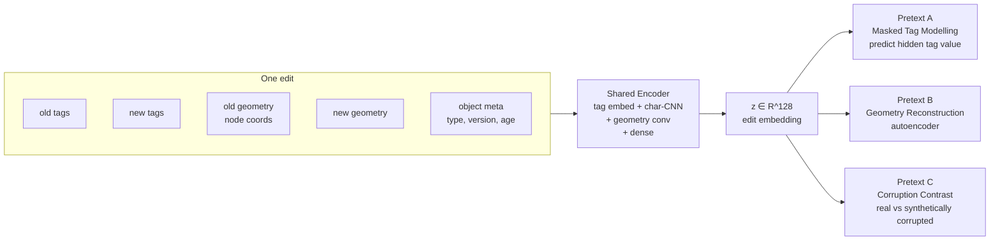
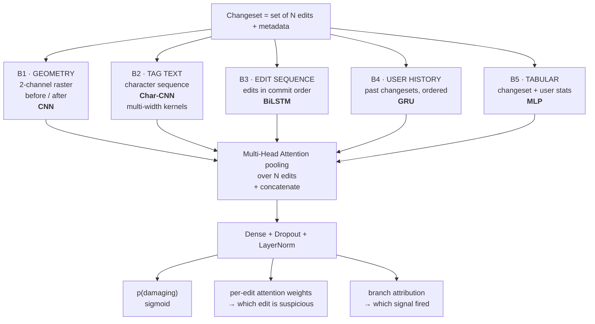
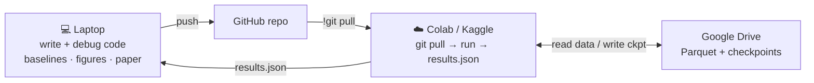

# MapGuard — Self-Supervised, Geometry-Aware Detection of Damaging Edits in OpenStreetMap

**Course:** Deep Learning (702AI0C008) — Mini Project
**Team size:** 4
**Status:** v3 — four-week scope (§13). Gate 1a passed; OSMCha label route live.
**Timeline:** 2026-09-04 to 2026-10-02
**Last updated:** 2026-09-04

---

## 1. Problem

OpenStreetMap is editable by anyone with no pre-approval. ~50,000 changesets land per day. Some are damaging:

| Class | Example | Detectable by |
|---|---|---|
| Geometry vandalism | Fake town drawn in the ocean; a road node dragged 400 km | shape / displacement |
| Semantic vandalism | Offensive or gibberish text written into a `name` tag | text content |
| Destructive edits | Large fraction of a city deleted | scale + operation mix |
| Careless newbie damage | One node dragged, road stretches across a country | geometry + user history |
| Broken imports | 10,000 duplicate buildings | changeset size + repetition |

Consumers of this data: Apple Maps, Meta, Amazon Logistics, every open routing engine, and humanitarian mapping (HOT / Red Cross disaster response). A bad edit becomes a broken route.

**Current defence is mostly manual.** Volunteers read changesets by hand in OSMCha, assisted by rule-based flags with poor precision.

---

## 2. How industry actually solves this today

This is the part that shapes our architecture. All of it is documented publicly.

| Organisation | System | Approach | What we take from it |
|---|---|---|---|
| **Meta** | Daylight Map Distribution (2020–Nov 2024) | **User embeddings** — word2vec skip-gram over user edit sequences, 32-dim, 1.6M users. Shipped to production. Released the first OSM vandalism corpus (1M edits, `name` attribute). CIKM '21. | Users are the strongest single signal. We modernise `user2vec` into a learned sequence encoder |
| **Overture Maps** | Successor to Daylight | Monthly planet snapshot → checks for coastline integrity, broken relations, vandalism → **~4 weeks to remediate** | Production today is **monthly batch**. Near-real-time is an open gap |
| **Wikimedia** | Revert Risk (replacing ORES) | Trained **solely on historical trace data** — revert history as ground truth, no hand labels. Served on Lift Wing. Their LLM variant is too slow (~1 s median) so lightweight models still win | Validates our label strategy *and* our no-LLM design |
| **Uber** | CatchME | GPS-trace-derived map error detection; separate NLP/DL model over support tickets | Multi-signal fusion; errors are inferred, not reported |
| **Stripe** | Payments Foundation Model (2025) | Transformer **self-supervised** on tens of billions of transactions → dense per-transaction embeddings → fine-tuned heads. Card-testing fraud recall **59% → 97%** with no FP increase | The single closest analogue. Pretrain on unlabelled events, fine-tune on scarce labels — exactly our Stage 1 → Stage 2 |

**Synthesis:** the modern pattern for abuse detection is *self-supervised foundation encoder over event sequences, fine-tuned per task, with entity (user) embeddings as a first-class input.* Nobody has applied that pattern to OSM. That is our project.

### Academic state of the art

| Work | Year | Method | Result |
|---|---|---|---|
| OSMPatrol | 2012 | hand-tuned rules | F1 69.15 |
| WDVD (Wikidata) | 2016 | random forest, text features | F1 72.20 |
| OSMWatchman | 2020 | random forest, **buildings only** | F1 74.01 |
| GloVe+CNN | community | text embeddings + CNN | F1 76.96 |
| Meta user embeddings | 2021 | word2vec user vectors + classifier | production |
| **Ovid** (SOTA) | 2021/22 | multi-head attention over edits | **F1 81.66** |

All F1 figures above are on a **50/50 balanced test set**. Real-world prevalence is far below 1%, so none of these numbers describe operational performance.

---

## 3. Verified gaps

Read directly from the Ovid paper's feature tables, not its abstract. Ovid uses:

- **Changeset:** counts of creates/modifies/deletes/edits; **bounding box only**; editor app, comment length, `imagery_used`
- **User:** aggregate counts of past contributions; account age; active weeks; top-12 keys used
- **Edit:** object type, version no., #previous authors, #tags, #valid tags, edit op, time since previous version, and `name changed` **as a boolean**

| # | Gap | Evidence |
|---|---|---|
| **G1** | **No real geometry.** Bounding box only — no shape, no displacement, no area change, no topology | Ovid §3.1.1. Ovid itself notes the one geometry-aware prior work (OSMWatchman) *"is limited to the building domain"* |
| **G2** | **No tag content.** `name changed` is a boolean; what was actually typed is never read | Ovid §3.1.3 |
| **G3** | **User history is aggregates, not a sequence.** Counts and dates, no temporal order | Ovid §3.1.2 |
| **G4** | **Large changesets are gutted.** Above threshold `th_e,max` the edit vector is **zeroed**; model falls back to user+changeset features. Mass vandalism and broken imports *are* large changesets | Ovid §3.2 |
| **G5** | **Balanced-set evaluation.** Negatives randomly downsampled to match positives | Ovid §4.1 |
| **G6** | **No temporal generalisation test.** Trained and tested on 2014–2019; never evaluated on later data | whole paper |

### Independent confirmation

The 2024 survey *ML Updates for OpenStreetMap: Analysis of Research Gaps and Future Directions* (arXiv 2407.03365) independently names as open gaps:

- *"leveraging unlabeled OSM data for model pre-training, despite its abundance"* → **our Stage 1**
- geometry beyond simple point/polygon classification → **our G1**
- *"inconsistent benchmarking practices"* → **our G5/G6**
- industry/academia gap on *"real-time processing"* → **our Corpus D live replication stream**

Our contributions are literally three of the gaps a 2024 survey asked for. This section is the lit-review deliverable (2 marks).

---

## 4. The idea

> **Teach a network what normal map editing looks like — for free, from millions of unlabelled edits — then fine-tune it to spot the abnormal, and give it the one signal every prior model discards: the actual shape of what changed.**

Two stages, following the Stripe pattern:

**Stage 1 — Edit Foundation Encoder (self-supervised, no labels).** Learns a 128-d representation of "a normal OSM edit" from unlimited unlabelled data via three pretext tasks.

**Stage 2 — Changeset classifier (supervised).** Loads the pretrained encoder, adds geometry/text/sequence/user branches, fine-tunes on the 18,276 labelled changesets.

Why fusing beats either alone: self-supervised tag modelling on its own is a solved, boring task. As pretraining it becomes the answer to the field's stated #1 blocker — Ovid's own abstract names *"the lack of annotated data"* as the core difficulty.

---

## 5. Architecture

### 5.1 System overview



### 5.2 Stage 1 — Edit Foundation Encoder

Input is one **edit** (one object changed), not a whole changeset.



**Pretext A — Masked tag modelling.** Hide one tag value, predict it from the remaining tags plus object context. Teaches co-occurrence: `highway=residential` implies a street-like `name` and plausible `maxspeed`; `place=city` does not belong in open ocean.

**Pretext B — Geometry reconstruction.** Autoencode the polyline/polygon into `z` and rebuild it. Reconstruction error is itself an anomaly score at inference.

**Pretext C — Corruption contrast.** We synthesise damage — displace geometry, scramble a name, ×100 the area, delete a chunk — and train the encoder to separate real from corrupted. Free supervision, unlimited volume. This is the highest-value pretext task because the corruptions are chosen to mimic real vandalism modes.

Loss: `L = L_mask + λ₁·L_recon + λ₂·L_contrast`. The λ weights are an ablation.

### 5.3 Stage 2 — Changeset classifier

A changeset is a **variable-length set of edits**. Five branches, attention fusion.



| Branch | Closes gap | Course concept | Unit |
|---|---|---|---|
| B1 Geometry CNN | **G1** | convolution, pooling, striding, param counting | U4 |
| B2 Char-CNN | **G2** | 1-D convolution; multi-width parallel kernels = Inception idea | U4 |
| B3 Edit BiLSTM | **G4** | LSTM, BPTT | U5 |
| B4 User GRU | **G3** | GRU; modernises Meta's `user2vec` | U5 |
| B5 Tabular MLP | baseline parity | perceptron → MLP → backprop | U2 |
| Attention fusion | reimplements Ovid | beyond classroom | — |
| Stage 1 → Stage 2 | label scarcity | **transfer learning** (lab expt 8, off-image) | U4 |

### 5.4 Two rules the architecture must obey

Both come out of the plan review; both are silent correctness bugs if forgotten.

**Rule 1 — nothing is zeroed, ever (closes G4 properly).** Ovid discards the edit
vector above a size threshold. A changeset can hold 50,000 edits, so we cannot simply
attend over all of them either. Instead, encode hierarchically:

| Level | Over what | Truncates? |
|---|---|---|
| Changeset summary | **all N edits** — op mix, type mix, tag-key histogram, geometry moments (max/mean/p95 displacement, total area delta), text-bearing edit count | **never** |
| Per-edit encoding | stratified sample of up to **K = 256** edits: top displacement, top area change, all text-bearing edits, then random fill | yes, and the ratio `K/N` is itself an input feature |
| Attention pooling | the K sampled edits | — |

Scale therefore always reaches the classifier exactly, even when the per-edit detail is
sampled. That is what makes the G4 claim defensible.

**Rule 2 — user features are point-in-time.** Every B4 sequence and every B5 user
statistic is computed **only from changesets with `created_at < target.created_at`**.
Computing them from the full dump leaks the future: for a 2016 target the model would
see that the account was blocked in 2017, which is a perfect and worthless predictor.
This is enforced in the feature builder and asserted by a test, not left to discipline.

### 5.5 Three outputs, not one

Ovid emits a score. A human reviewer needs to know *where to look*:

1. `p(damaging)` — calibrated probability
2. **which edit** inside the changeset is most suspicious — read off attention weights
3. **which signal fired** — geometry / text / user / scale

Output 2 and 3 cost nothing extra and are a genuine usability contribution.

---

## 6. Deep learning concepts — syllabus mapping

| Unit | Concept | Where used |
|---|---|---|
| **U2** | Perceptron → MLP → feedforward | B5 tabular branch |
| **U2** | Backpropagation, BPTT | end-to-end; BPTT through B3/B4 |
| **U2** | Activation functions | ReLU trunk, sigmoid output, tanh in LSTM gates. Ablation: ReLU / LeakyReLU / GELU |
| **U2** | Loss functions | BCE → **focal loss** (imbalance) |
| **U3** | SGD, mini-batch, momentum, Nesterov, AdaGrad, RMSProp, Adam | direct reuse of **lab expt 6** protocol → real results table |
| **U3** | L1/L2, dropout, early stopping | early stopping on val **PR-AUC**, not accuracy |
| **U4** | Convolution, pooling, striding, param counting | B1 (2-D), B2 (1-D) |
| **U4** | Inception / ResNet ideas | multi-width parallel kernels in B2; residual connections when stacking |
| **U4** | **Transfer learning** | lab expt 8 procedure, applied off-image: pretrain → freeze → fine-tune |
| **U5** | Vanilla RNN, vanishing gradients | we **train one deliberately**, plot gradient-norm collapse over 200-step user histories, then justify LSTM. Strong report section |
| **U5** | **LSTM / GRU** | B3 and B4; LSTM vs GRU vs BiLSTM comparison |

**Beyond classroom:** multi-head attention · self-supervised pretraining · embedding layers · multimodal fusion · focal loss · PR-AUC / precision@k · model calibration.

Every unit genuinely used. Nothing name-dropped.

---

## 7. Data plan — three corpora

Gate 0 killed the original single-corpus plan; the plan review (`docs/planning/PLAN_REVIEW.md`)
then killed the *replacement's* central assumption, that historical geometry is out of
reach. Both routes to it were verified on 2026-09-04. What follows is the corrected plan.

### Corpus A — Ovid-era labelled, 2014–2019 (train + comparability)

| Item | Source | Status |
|---|---|---|
| `ovid_labels.tsv` | 18,276 rows, 9,138 pos / 9,138 neg, ids 19,739,784–79,067,468 | downloaded and inspected |
| Changeset contents | `GET /api/0.6/changeset/<id>/download` | verified 3/3, **1.2 s/call** (not 0.2 s) |
| Previous object state | `GET /api/0.6/{nodes,ways}?{nodes,ways}=<id>v<ver>` — **batched, up to 725 ids** | verified 200 |
| **Before/after geometry** | **Overpass `adiff` over the changeset bbox and `[created_at, closed_at]`** | **verified — full resolved polylines back to 2012** |
| User histories | changeset replication stream (recent) or `changesets-latest.osm.bz2`, **8.72 GB** | public, no login |
| Presumed-negative pool | ~50,000 unlabelled ids sampled from the same era, for R2 | to fetch, ~4.2 h |

The `adiff` route is what makes Corpus A carry branch **B1**. Without it the geometry
contribution would only ever be tested on a corpus with no labels and no baseline.

**Per-changeset `adiff` recipe** (verified on changeset 52850166):

1. `GET /api/0.6/changeset/<id>` → `created_at`, `closed_at`, bbox
2. `[adiff:"<created_at>","<closed_at>"];(node(<bbox>);way(<bbox>););out geom meta;`
3. keep only actions whose `<new>` carries `changeset="<id>"`

Gotchas, both hit during verification: `[bbox:...]` in the setting block does **not** parse
alongside `adiff` — put the bbox on each statement. And a changeset with a global or
missing bbox must fall back to versioned multi-fetch rather than asking Overpass for the
planet.

### Corpus B — evaluation role dropped (2026-09-04)

The `real-changesets` bucket window (Feb 2024 – Mar 2025, re-verified at **82% density**,
59/72 probes, ~14M usable changesets) was to be a second labelled corpus for a
five-year-drift test.

**Dropped, because Corpus D supersedes it.** Once the OSMCha token arrived, live 2026 data
turned out to have *human-reviewed* labels and full `adiff` geometry — everything Corpus B
was for, on more recent data, with a stronger label source. Building a second labelled
corpus to test drift to 2025 when we can test drift to *today* is work with no reader.

What this costs: regime **R3a** only. **R3b** survives and is the better experiment.

**The bucket itself stays** — as the source for Corpus C. It is still the cheapest bulk
before/after geometry available, which is exactly what the pretext tasks want, and no
labelling effort is needed for that role.


### Corpus C — Unlabelled pretraining

Bulk `real-changesets` JSONs from the same window. Target 500k–2M edits.

> **Disjointness rule (non-negotiable).** Corpus C excludes every changeset id **and every
> uid** that appears in the Corpus D evaluation split. Pretraining on the test
> set would make R4 — the single most important figure in the paper — meaningless.

### Corpus D — Live 2026 (the real temporal test)

**The v1 plan was wrong that current OSM data is only reachable one changeset at a time.**
Measured 2026-09-04:

| Stream | Sequence | Freshness |
|---|---|---|
| `planet.openstreetmap.org/replication/minute/` | 7,271,812 | `2026-09-04T04:12:47Z` |
| `planet.openstreetmap.org/replication/changesets/` | 7,170,065 | `2026-09-04T04:12:51Z` |
| `planet.openstreetmap.org/replication/day/` | 5,105 | `2026-09-04T00:00:00Z` |

Both streams are live to the current minute, bulk, free and account-free. One
changeset-replication minute file is ~2.9 KB gzipped and carries `id, created_at,
closed_at, num_changes, user, uid, bbox, comments_count` plus the `comment`,
`created_by`, `locale` and `source` tags — everything B5 and the revert miner need.
A **month** of changeset metadata is roughly 125 MB gzipped.

Corpus D is therefore built as: harvest the changeset-replication stream over a chosen
2026 window → sample → pull contents per changeset from the API → enrich geometry with
`adiff` → label via OSMCha `harmful` and revert mining. This is what turns R3 from "test
on later data" into a genuine 2026 evaluation, and it is the answer to the requirement
that the project use the latest OSM data.

### What we deliberately do not use

- **Full-history planet PBF** — 162 GB. Out of reach on free tiers; `adiff` gets the same
  information for the changesets we care about.
- **Planet PBF** — 94.6 GB, and it is a snapshot, so it has no before-state anyway.

---

## 8. Gates

### 8.1 Gate 0a — bucket coverage of Ovid labels: FAILED

140 probes stratified across 19.7M–79.1M, both classes: **0/140, all 404**, uniform across
every stratum. `real-changesets` simply does not hold 2014–2019 changesets.
(`results/gate0_coverage.json`)

### 8.2 Gate 0b/0c — API fallback and bucket bounds: PASSED

| Question | Result |
|---|---|
| `GET /api/0.6/changeset/<id>/download` on old changesets | **3/3**, HTTP 200, 1.4–2.9 KB, **~1.2 s each** — full tag diffs, ops, versions, inline `lat`/`lon` for nodes |
| `GET /api/0.6/<type>/<id>/<version-1>` | **2/2**, HTTP 200. Returns tags; ways return `<nd>` refs with no coordinates |
| Bucket window | **~147M – 164M**, Feb 2024 → ~Mar 2025, sharp cutoff between 164M and 165M |
| Current max changeset id | **188,495,159** (2026-09-03) |

> **Correction.** v1 of this plan reported "~0.2 s each" for the changeset download. The
> repository's own `results/gate0b_fallback.json` records **1.2, 1.17 and 1.26 s**, and fresh
> probes on 2026-09-04 reached 8.2 s at the tail. Every fetch budget below is built on
> **1.2 s**.

### 8.3 Gate 0d — plan review probes: PASSED, and they overturn two v1 conclusions

Raw output: `results/gate0d_review_probes.json`.

| Probe | Question | Result |
|---|---|---|
| P1 | Is previous state really one call per object? | **No.** Versioned multi-fetch `?nodes=<id>v<ver>` / `?ways=<id>v<ver>` returns 200, up to 725 ids per call |
| P2 | Can we get before/after way geometry for 2014–2019? | **Yes.** Overpass `adiff` returns `<old>`/`<new>` with coordinates resolved onto the way |
| P3 | Does per-changeset `adiff` work? | **Yes** — bbox + `[created_at, closed_at]`, filter by changeset id. 5/5 actions attributed correctly |
| P4 | Is current OSM data bulk-reachable? | **Yes.** Minute and changeset replication both live to the current minute |
| P5 | Is changeset replication rich enough? | **Yes** — 16 fields including `num_changes`, bbox, `comment`, `created_by` |
| P7 | Is the bucket window dense? | **82%** (59/72), no hole, ~14M usable |
| P8 | Is OSMCha readable without a token? | **No** — HTTP 401. Decision 5 is a real blocker |
| P9 | How big are the bulk artefacts? | changesets dump **8.72 GB**; planet 94.6 GB; full-history 162 GB |

**Consequence:** branch B1 runs on Corpus A, and Corpus D becomes possible at all. Corpus B
lost its reason to exist as a separate labelled corpus — see §7.

### 8.4 Gate 1 — must pass before any modelling (week 1)

| Gate | Question | Pass criterion | Owner |
|---|---|---|---|
| **1a** | Does `adiff` scale to a real batch? | 100 random Corpus A changesets enriched end-to-end; **≥90% return usable before/after geometry**; median wall-clock recorded | WS1 |
| **1b** | Is the public Overpass instance enough for 18k queries? | measure sustained throughput and 429/504 rate over 30 min. If it will not carry 18k, pick a mirror or a subset before committing | WS1 |
| **1c** | Does the leakage tripwire stay quiet? | baseline **B0** (comment length + editor string + account age only) scores **F1 < 0.70** on R1b. If it reaches ~0.8 the labels leak and everything downstream is void | WS2 |
| **1d** | Does Keras 3 handle the real model shape? | toy model: 5 heterogeneous inputs, ragged set of edits, masked multi-head attention, trains one epoch without fighting. Pass → Keras. Fail → PyTorch, **decided by day 5** | WS3 |
| **1e** | What is Stage-1 throughput? | measured edits/sec on one Kaggle P100 at the real batch size. **Only run if Stage 1 survives the week-4 decision (§13)** | WS4 |

### 8.5 Corpus D labels — RESOLVED 2026-09-04

The token arrived and the route works. Measured against the live OSMCha API:

| Window | `harmful=True` | `checked=True, harmful=False` |
|---|---|---|
| 2026-08-25 → 2026-09-04 (10 days) | 252 | 566 |
| 2026-01-01 → 2026-09-04 (harvesting) | 3,200+ and counting | — |

69 distinct reviewers in the ten-day sample. Top harmful reasons: `New mapper`,
`Mapbox: Fictional mapping`, `mass modification`, `User has multiple blocks`,
`suspect_word`, `possible import`.

**Note the distribution differs from the Ovid labels by construction.** Ovid positives are
"someone reverted this"; these are "a human read it and called it damaging". Where the two
disagree is itself worth a paragraph in the paper.

**Reviewed negatives, not assumed ones.** The clean class is fetched as
`checked=True, harmful=False` — a reviewer looked and said it was fine. Using unreviewed
changesets as negatives would encode reviewer *attention* into the class: reviewers look
at suspicious things, so anything unexamined is clean by construction.

The query must be date-bounded; an unfiltered `harmful=True` request times out because the
endpoint scans. Revert mining off the replication stream remains available as a volume
fallback, but is no longer needed on the critical path.

---

## 9. Compute plan

### Measured local machine

```
CPU   : Intel i5-8265U @ 1.60 GHz — 4 cores / 8 threads (2018 mobile, thermally limited)
RAM   : 7.82 GB total — 0.77 GB free at measurement
Disk  : C: 475.6 GB total, 72 GB free
GPU   : integrated — no CUDA
```

### Two hard constraints

1. **No CUDA.** All GPU work goes to Colab or Kaggle. Non-negotiable.
2. **0.77 GB free RAM.** Anything that loads a dataframe locally will thrash. Heavy data
   work goes to the cloud — Colab 12.7 GB, Kaggle ~29 GB.

The OneDrive trap is resolved: the project now lives at
`C:\AyushGarg\projects\personal\osm_mapguard`, outside OneDrive. **Bulk data still goes in
`C:\osm-data\`, never in the repository.**

### Fetch budgets — rebuilt on measured latency

| Job | Volume | Rate | Wall clock |
|---|---|---|---|
| Corpus A contents | 18,276 changesets | 1.2 s/call, 4 concurrent | **~1.5 h** |
| Corpus A `adiff` enrichment | ~18k Overpass queries | 3–4 s/query, 2 slots | **~10 h**, Gate 1b decides whether to subset |
| R2 presumed-negative pool | 50,000 changesets | 1.2 s/call, 4 concurrent | **~4.2 h** |
| Corpus C bulk (pretraining) | ~100k bucket JSONs | S3, parallel | hours, bandwidth-bound, **week 4 only** |
| Corpus D changeset metadata | 1 month of replication | ~125 MB gz | minutes |

Split across 4 machines where it helps. Be polite: 1 req/s per worker, real User-Agent,
back off on HTTP 509, resume from disk cache.

### Where each stage runs

| Stage | Where | Why |
|---|---|---|
| Corpus A/D fetch | Colab | fast network, keeps GB off the laptop |
| Parse → Parquet | Colab (12.7 GB) | laptop has 0.77 GB free |
| Feature store | Google Drive | persistent across sessions |
| Replication / dump mining | Colab | decompression is CPU-heavy |
| Baselines (B0, LogReg, XGBoost) | Laptop | small; DuckDB keeps RAM flat |
| **Stage 1 pretraining** | **Kaggle** (P100 / 2×T4) | longest job; 30 GPU-h/week explicit quota |
| **Stage 2 training** | **Colab T4** | fast iteration |
| Ablation grid (~40 runs) | Kaggle | batch overnight |
| Figures, paper | Laptop | light |

### Working loop



Rules that keep this loop tight:

- Notebooks stay **thin** — `git pull`, `pip install -r requirements.txt`, import from `.py`
- **Checkpoint to Drive every epoch.** Sessions die at 12 h and after 90 min idle; every run must resume
- Featurised Parquet lives on Drive, uploaded once
- Metrics go to `results/*.json`, one small file back, not screenfuls of stdout

---

## 10. Tools

| Layer | Tool | Why |
|---|---|---|
| Language | Python 3.12 (TensorFlow does not support 3.14) | — |
| Out-of-core SQL | **DuckDB** | queries Parquet larger than RAM. The key tool for an 8 GB machine |
| Dataframes | **Polars** (+ pandas where needed) | far lower memory than pandas |
| Columnar IO | PyArrow / Parquet | compressed, columnar, range-readable |
| HTTP / S3 | `requests`, `boto3 --no-sign-request` | bucket is public |
| OSM parsing | `lxml.etree.iterparse`, `bz2` / `gzip` streaming | constant memory over 8.72 GB |
| Geometry | Shapely, pyproj | area, length, displacement, Hausdorff |
| DL framework | **Keras 3 (TF backend)**, pending **Gate 1d** | course-aligned; PyTorch is the fallback if 1d fails |
| Baselines | scikit-learn, XGBoost | B0, LogReg, RF, GBDT |
| Tracking | Weights & Biases (free) | the ablation grid is unmanageable in spreadsheets |
| Viz | matplotlib, seaborn, Folium, contextily | figures and demo |
| Paper | LaTeX on Overleaf, IEEE template | plagiarism-checked deliverable |

**No paid APIs. No LLM anywhere in the pipeline.** Matched to the Wikimedia finding that
LLM-based revert-risk is too slow for production.

---

## 11. Evaluation protocol

The methodological contribution. Five regimes; **R3a was dropped with Corpus B** (§7).

| Regime | Setup | Purpose | Closes |
|---|---|---|---|
| **R1b Balanced, user-disjoint — Ovid's protocol** | 70/10/20, **no uid crosses splits** | the headline number, apples-to-apples with Ovid's F1 of 81.66: Ovid's own split is user-disjoint (Tempelmeier & Demidova 2021, §4.1; corrected 2026-09-18 — v3 wrongly called the random split Ovid's protocol) | — |
| **R1a Random, user-leaky** | same data, random 70/10/20 | an upper bound only: how much a model gains from recognising authors. The R1a–R1b gap is itself a result | — |
| **R2 Realistic prevalence** | prevalence-corrected PR curves at 1% and 0.1%; the sampled 1:100 set is a stretch goal | operational truth. **PR-AUC and precision@k, never F1** | **G5** |
| **R3b Temporal — live 2026** | train Corpus A, test Corpus D, OSMCha-labelled | drift to today. Nobody has published this | **G6** |
| **R4 Label efficiency** | 10/25/50/100% of labels, pretrained vs scratch | does pretraining help? **Conditional on Stage 1 surviving the timeline (§13)** | core claim |


### R2, stated precisely

The corpus has 9,138 negatives. **1:100 needs 913,800 and 1:1000 needs 9,138,000 — you
cannot upsample your way to a lower positive rate.** So:

1. **Primary — prevalence correction.** Reweight negatives on the balanced test set by
   `w = ((1 - p) / p) * (n_pos / n_neg)` for target prevalence `p`, and recompute the PR
   curve. Exact, free, standard.
2. **Confirmatory — a genuinely sampled 1:100 set.** ~50,000 unlabelled Ovid-era
   changesets as presumed-negatives. True vandalism prevalence among them is well under
   1%, so contamination is bounded and quantifiable; report it as a caveat.
3. **Prevalence 0.1% is reported weight-corrected only**, and labelled as such.

### Integrity checks that gate the results

- **B0 tripwire** (Gate 1c) — comment length + editor + account age only. F1 at or above
  0.70 means the labels leak and no downstream number is trustworthy.
- **Point-in-time user features** — asserted by a test, not by discipline (§5.4 Rule 2).
- **Corpus C disjointness** — no evaluation changeset id or uid may appear in pretraining (§7).
- **Zero-shot corruption transfer** — before fine-tuning, score the frozen Pretext-C head
  on the real labelled set. AUC near 0.5 means the synthetic corruptions are the wrong
  distribution and Pretext C needs redesigning. Report the number either way.
- **Manual label audit** — 100 randomly drawn labelled changesets read by hand, two
  reviewers, to estimate the noise rate. Turns inherited label noise from a hand-wave into
  a measured limitation.

### Ablation grid

| Config | B1 geom | B2 text | B3 edit-seq | B4 user-seq | B5 tab | Stage-1 pretrain |
|---|---|---|---|---|---|---|
| B0 tripwire | ✗ | ✗ | ✗ | ✗ | 3 features | ✗ |
| Ovid-repro | ✗ | ✗ | ✗ | ✗ | ✓ | ✗ |
| +geometry | ✓ | ✗ | ✗ | ✗ | ✓ | ✗ |
| +text | ✗ | ✓ | ✗ | ✗ | ✓ | ✗ |
| +sequences | ✗ | ✗ | ✓ | ✓ | ✓ | ✗ |
| Full, scratch | ✓ | ✓ | ✓ | ✓ | ✓ | ✗ |
| **Full, pretrained** | ✓ | ✓ | ✓ | ✓ | ✓ | ✓ |

Six rows, **2 seeds each** at this timeline (§13); the original grid was ~40 runs.

Plus a **per-vandalism-type breakdown** — geometric vs semantic vs destructive. If geometry
only helps the geometric subclass, that is a precise finding, not a null result.

### Expected results — stated in advance

| Regime | Expectation | Confidence |
|---|---|---|
| R1b user-disjoint (Ovid's protocol) | compared directly with 81.66 | medium |
| R1a random, user-leaky | **above R1b** | high — that gap is the point |
| R2 realistic | F1 collapses for everyone to roughly 0.2–0.4; PR-AUC becomes the real metric | high that it collapses; the number is the finding |
| R3b temporal, live 2026 | measurable drop, and a label-source shift on top of it — OSMCha review is not revert history | high that it drops; disentangling the two effects is the interesting part |
| R4 label efficiency | pretrained above scratch, gap widest at 10% | medium-high, **if Stage 1 runs at all** |

### Failure modes — and why neither sinks the project

- **Geometry adds little.** The finding becomes *geometry helps only the geometric
  subclass*, supported by the per-type breakdown. Still publishable.
- **Pretraining does not help.** The finding: *label scarcity is not the bottleneck —
  feature coverage is.* That contradicts a stated assumption of the field, including the
  Ovid abstract. Also publishable.

**No outcome leaves us empty-handed.** That is deliberate.

---

## 12. Risk register

| Risk | Severity | Mitigation |
|---|---|---|
| ~~Gate 0 fails~~ | ~~High~~ | **Resolved — it did fail.** Multi-corpus design, §7 and §8 |
| ~~Corpus A has no geometry~~ | ~~High~~ | **Resolved — the premise was false.** `adiff` and versioned multi-fetch verified, §8.3 |
| ~~Latest OSM data unreachable in bulk~~ | ~~Medium~~ | **Resolved — false.** Replication streams live; Corpus D added |
| ~~OneDrive syncs GBs~~ | ~~High~~ | **Resolved** — project outside OneDrive |
| Overpass cannot carry 18k adiff queries | **Medium** | Gate 1b measures it first. Fallbacks: mirror instance, geometry subset, versioned multi-fetch |
| ~~Corpus D labels unobtainable~~ | ~~Medium~~ | **Resolved 2026-09-04** — OSMCha token verified, 3,200+ harmful labels harvested for 2026, §8.5 |
| Label leakage (revert text in the record) | **High** | Gate 1c B0 tripwire before any DL work |
| Future leakage via user features | **High** | Point-in-time rule plus unit test, §5.4 Rule 2 |
| Pretraining contaminates the test set | **High** | Corpus C disjointness rule, §7 |
| Pretext C learns synthetic artefacts | Medium | Zero-shot transfer check before fine-tuning |
| Keras 3 fights ragged multi-input attention | Medium | Gate 1d, day-5 decision point |
| Stage 1 exceeds 30 GPU-h/week | Medium | Gate 1e measures throughput before the budget is set |
| OSM API throttling | Medium | 1 req/s per worker, resumable cache, back off on 509, split across 4 machines |
| Laptop RAM exhaustion | **High** | DuckDB, Polars, streaming; heavy work on Colab and Kaggle |
| Label noise — a revert is not always vandalism | Medium | Identical protocol to Ovid keeps the comparison fair; measured by the 100-changeset audit |
| Colab session death mid-run | Medium | Checkpoint to Drive every epoch |
| Class imbalance | Medium | It *is* the contribution — focal loss, PR-AUC, threshold analysis |
| **Four weeks, not fifteen** | **High** | Scope cut in §13 with a stated drop order. G1, G2, G3, G5, G6 survive even the three-week version |
| Paper written in the last three days | **High** | Drafting starts in W3 in parallel with modelling, not after it |
| WS1 stalls the other three | **High** | `data/mock/` exists in the real schema today; schema frozen end of W1 |
| Scope creep from two fused ideas | Medium | Stage 1 is **ablatable**. If it fails, Stage 2 stands alone |
| Four-way coordination | Medium | Workstream split in §13; one owner per branch |

---

## 13. Phasing — the four-week plan

**The 15-week plan is gone.** As of 2026-09-04 the project has three to four weeks, not a
semester. That is not a matter of working faster: roughly two thirds of the original scope
has to go, and this section is the record of which two thirds and why.

Budget: 4 people, ~20 h/week, 4 weeks ≈ **320 person-hours**. The original scope was over
700. What follows fits.

### What was cut, and what it costs

| Cut | Saves | Costs |
|---|---|---|
| **Corpus B as a labelled corpus** (§7) | ~2 weeks of labelling and bulk download | regime R3a only; R3b is the better test |
| **Stage 1 down to one pretext task** — corruption contrast, the highest-value one | ~1 week | the λ ablation; masked-tag and reconstruction pretexts become future work |
| **Stage 1 itself is week-4-if-time** | up to 1 week | R4 becomes conditional. Stage 2 was always designed to stand alone |
| **Geometry enrichment subset** if Gate 1b says the full 18,276 will not fit | ~8 h wall clock | wider confidence intervals, not a broken result. Sample by changeset id, never by size or user |
| **Ablation grid: 6 core rows, 2 seeds** instead of ~40 runs | ~1 week of GPU and babysitting | per-config error bars get wider; the contribution table survives intact |
| **Interactive demo becomes a scripted walkthrough** | ~3 days | a recording instead of a live service |

### What was not cut, and why

- **Gate 1c**, the leakage tripwire. If the labels leak, every number after it is void.
  Two hours of work that protects the whole project.
- **Gate 1d**, the framework spike. Finding out in week 3 that Keras fights ragged masked
  attention is fatal at this timeline.
- **R2**, prevalence correction. It is cheap, and it is a headline contribution.
- **The point-in-time rule and the user-disjoint split.** These are correctness, not scope.

### Week by week

Week 1 begins **2026-09-04**.

| Week | Dates | Goal | Owner focus |
|---|---|---|---|
| **W1** | Sep 4 – Sep 10 | Gates 1b/1c/1d green. Corpus A metadata, contents and geometry collected. Feature store emitting Parquet. Everyone else building against `data/mock/` | WS1 leads; WS2–4 on mock |
| **W2** | Sep 11 – Sep 17 | Baselines B0/LogReg/XGBoost, Ovid reproduction, R1a+R1b harness. Branches B5 and B2 training end to end | WS2 + WS3 |
| **W3** | Sep 18 – Sep 24 | B1 geometry, B3 edit-sequence, B4 user-history, attention fusion. Full model trains. R1 and R2 results. Corpus D featurised. **Paper drafting starts in parallel** | WS3 + WS4; WS2 on evaluation |
| **W4** | Sep 25 – Oct 2 | R3b on live 2026. Stage 1 **if the week-3 model is stable**. 6-row ablation, 2 seeds. Figures, walkthrough, paper complete | all four |

### If it compresses to three weeks

Drop in this order, and stop when it fits:

1. Stage 1 entirely — R4 goes, the paper becomes a supervised-fusion contribution
2. The B3 edit-sequence branch — B4 already carries the sequence argument for U5
3. R2 sampled 1:100 — keep the weight-corrected version only
4. The per-vandalism-type breakdown

**G1, G2, G3, G5 and G6 all survive even the three-week version.** Only G4 and the
self-supervision claim are at risk, and both are explicitly ablatable.

### Hard dependencies

WS1 gates everyone. Two rules keep that from stalling three people for a week:

- `data/mock/` exists today, in the real schema. WS2–4 build against it from day one.
- The feature-store schema is frozen at the end of W1. After that it is a versioned
  change, not an edit.

### Workstream split (4 people, one owner each)

| Owner | Workstream | Four-week scope |
|---|---|---|
| **WS1** | Data pipeline | Gates 1a/1b, Corpus A fetch and `adiff` enrichment, Corpus D, feature store, point-in-time user histories |
| **WS2** | Baselines and evaluation | Gate 1c, B0 tripwire, LogReg/XGBoost, Ovid reproduction, R1/R2/R3b harness, calibration |
| **WS3** | Model — Stage 2 | Gate 1d, B1–B5, hierarchical encoder, attention fusion, training loop |
| **WS4** | Stage 1, figures, demo | Corruption generator and the single pretext task (W4, conditional), figures, walkthrough |

All four co-author the paper. Drafting starts in W3, not W4 — a paper written in the last
three days is the most common way a finished project scores badly.


---

## 14. Paper

> **Geometry-Aware, Self-Supervised Detection of Damaging Edits in OpenStreetMap**

Claimed contributions, each checkable against §3:

1. First deep model to use **actual edit geometry** for general OSM vandalism — and, via
   Overpass `adiff`, the first to do so **on the published 2014–2019 benchmark**, so the
   claim is testable against Ovid rather than against a corpus of our own making
2. First application of **self-supervised pretraining** to OSM quality assurance — an open
   gap named by arXiv 2407.03365 (2024)
3. First evaluation at **realistic prevalence**, under **temporal shift to live 2026 data**,
   and with a **user-disjoint split reported alongside the leaky one**
4. **Explainable output** — which edit, which signal — for the human review queue

Positioned as: *the Stripe and Wikimedia production pattern — self-supervised sequence
foundation model plus trace-derived labels — applied to a domain where production systems
still run monthly batch checks.*

---

## 15. Decisions

| # | Decision | Status |
|---|---|---|
| 1 | Gate 0 | **run — FAILED.** Multi-corpus design adopted, §8 |
| 2 | Keras 3 vs PyTorch | **Keras 3 on TensorFlow, pending Gate 1d.** Decide by day 5 |
| 3 | Timeline | **Four weeks, 2026-09-04 to 2026-10-02.** Scope cut accordingly, §13 |
| 4 | Region scope | **Global.** Every corpus is keyed by changeset id, not geography |
| 5 | OSM account and OSMCha token | **done 2026-09-04.** Token verified against the live API |
| 6 | Label route | **OSMCha `harmful` primary** — human-reviewed, and it works. Revert mining is the volume fallback if needed |
| 7 | Corpus A geometry route | **Overpass `adiff` primary, versioned multi-fetch fallback.** Verified, §8.3 |
| 8 | Latest-data route | **Changeset and minute replication streams.** Verified live 2026-09-04 |
| 9 | Relations | **Out of scope as a modelled object.** Counted in features, not geometrically encoded |
| 10 | Corpus B | **Dropped as a labelled corpus**, §7. The bucket survives as the Corpus C pretraining source |
| 11 | Stage 1 | **One pretext task, week 4, conditional.** Ablatable by design; Stage 2 stands alone |


### Environment note — local Python is 3.14

TensorFlow does not support 3.14. Local work needs a 3.12 virtual environment:

```
py -3.12 -m venv .venv
.venv\Scripts\activate
pip install -r requirements.txt
```

---

## 16. Licensing, ethics and data handling

- **Licence.** OSM data is ODbL. Every derived dataset, figure and table must carry
  "© OpenStreetMap contributors". Any released corpus is a Derivative Database and must be
  released under ODbL too.
- **Personal data.** `uid` and `user` identify real people, and this project labels their
  edits as damaging. Keep the raw uid only in the local working store; **publish only a
  salted hash**, and never publish a username alongside a vandalism label.
- **No account-level claims.** The model scores changesets, not people. The paper must not
  present per-user scores or rankings.
- **Rate limits are an ethical obligation, not just a technical one.** The OSM API is
  donated infrastructure. 1 req/s per worker, honest User-Agent with contact, back off on 509.
- **Traceability.** Gate results, probe output and metrics are committed as JSON so every
  number in the paper traces to a file in `results/`.

---

## References

- Tempelmeier & Demidova. *Ovid: A Machine Learning Approach for Automated Vandalism Detection in OpenStreetMap.* SIGSPATIAL 2021. arXiv:2203.11087
- Tempelmeier & Demidova. *Attention-Based Vandalism Detection in OpenStreetMap.* WWW 2022. arXiv:2201.10406
- Li, Anderson & Niu. *Vandalism Detection in OpenStreetMap via User Embeddings.* CIKM 2021
- *ML Updates for OpenStreetMap: Analysis of Research Gaps and Future Directions.* arXiv:2407.03365, 2024
- Neis, Goetz & Zipf. *Towards Automatic Vandalism Detection in OpenStreetMap.* ISPRS IJGI 2012
- Truong, Touya & de Runz. *OSMWatchman: Learning How to Detect Vandalized Contributions in OSM Using a Random Forest Classifier.* ISPRS IJGI 2020
- Heindorf et al. *Vandalism Detection in Wikidata.* CIKM 2016
- Vaswani et al. *Attention Is All You Need.* NIPS 2017
- Stripe. *Payments Foundation Model.* Stripe Sessions 2025
- Wikimedia. *Language-agnostic Revert Risk model.* Meta-Wiki
- Overture Maps Foundation — data quality and validation documentation
- Registry of Open Data on AWS — `real-changesets`
- OpenStreetMap wiki — Planet.osm/diffs, Overpass API `adiff`, API v0.6 multi-fetch
