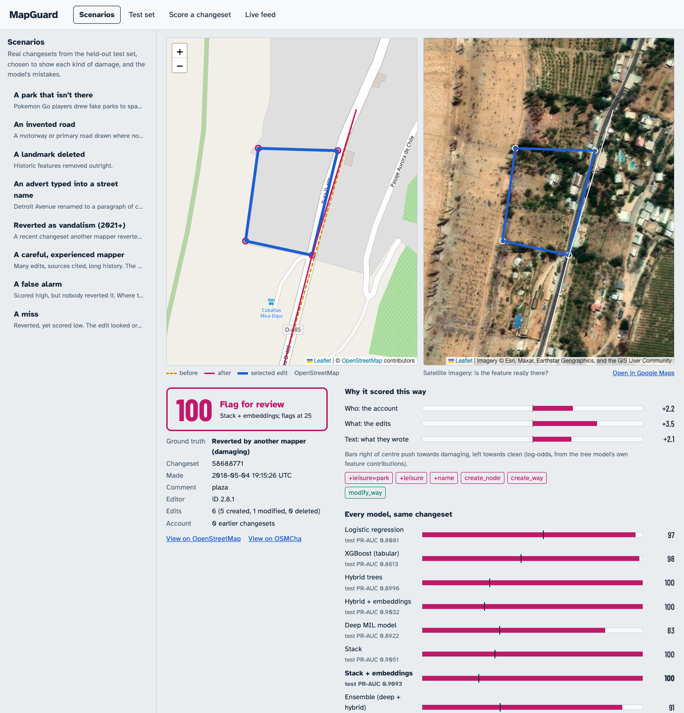

# MapGuard review console

A local web app that shows MapGuard at work: on real held-out changesets with round 4's stored
model outputs, on any changeset fetched from OpenStreetMap right now, and on a live feed.



## What it shows

| Mode | What you see | Where the numbers come from |
|---|---|---|
| **Overview** | Every held-out changeset with edit coordinates on a world map, coloured caught / false alarm / missed / cleared; headline metrics against Ovid; every model with its author-bootstrap interval; what the token model learned | round 4's stored outputs and `analysis/seeds.json` |
| **Scenarios** | Eight real test changesets: a fake park, an invented road, a deleted landmark, an advert typed into a name, a 2021+ vandalism revert, a careful mapper, a false alarm, a miss | round 4's stored outputs |
| **Test set** | All 3,607 ovid / 5,024 ovid_modern test changesets, filterable by outcome and searchable | round 4's stored outputs |
| **Score a changeset** | Paste any changeset id from OpenStreetMap or the OSM sandbox; it is fetched and scored now | the hybrid tree model, refit on this CPU |
| **Live feed** | The newest real changesets, scored as they close | the same refit model |

For a changeset, the screen answers four questions at once:

- **What and where.** The left map draws every edit, coloured by action: created green, modified blue, deleted red dashed, the state before the edit amber dashed, the selected edit magenta. Toggle before / after, nodes / ways, and click any shape to inspect that edit.
- **Is it real?** The right map shows the same spot from above (Esri satellite imagery), with Google Maps as an option. A fake park drawn over a street shows up as a park outline on bare ground.
- **How suspicious.** A dial with the score, the threshold tick, the verdict and, for test changesets, what really happened (caught, false alarm, missed, cleared).
- **Why.** Who / what / text bars (the tree model's own feature contributions, in log-odds), the edit patterns that pushed hardest, every edit ranked by the deep model's attention, the tag diff of the selected edit, and every round-4 model's score on the same changeset.

Usernames are never shown. Replayed changesets come from the pseudonymised release.

## Where the numbers come from

- **Replayed changesets** show the scores round 4 stored, the mean of 3 training seeds, read from its run folders. `tests/test_demo.py` checks, over HTTP, that the page receives exactly those numbers for every model.
- **Overview metrics** are round 4's `analysis/seeds.json`, unchanged (`tests/test_console.py`). Its outcome counts are recomputed from the stored scores at the validation threshold and match the error analysis (382 false alarms and 258 misses on ovid).
- **Live changesets** are scored by round 4's tree model ("hybrid"). Round 4 saved predictions, not trees, so `tree_model.py` refits it from the released feature store with the same code, frozen split and seed, and checks it against round 4: test PR-AUC ovid 0.902 vs 0.899, ovid_modern 0.936 vs 0.936 (the small gap is likely the newer XGBoost version on the laptop). A live changeset is featurised by the training feature builder itself (`src/mapguard/features/build_store.py`).
- **What does not run live:** the deep model and the stack need the GPU-trained network, so live edits are ranked by the edit-pattern model instead of attention. The page says so wherever it applies.

## Run it

**1. Environment** (Python 3.12, no TensorFlow), from the repository root:

```bash
uv venv --python 3.12 visual/.venv
uv pip install --python visual/.venv -r visual/requirements.txt
```

On macOS, XGBoost also needs `brew install libomp`.

**2. Data.** The pseudonymised feature store from release v1.1.0 (80 MB). The scripts look for it in this order:
1. `MAPGUARD_FEATURE_STORE`;
2. `$MAPGUARD_DATA/release/v1.1.0/feature_store`;
3. `dist/mapguard-dataset-v1.1.0/feature_store`;
4. `~/osm-data-mac/release/v1.1.0/feature_store`.

```bash
gh release download v1.1.0 -R ayushmgarg/osm-mapguard -p "mapguard-dataset-v1.1.0.zip" -D dist
```

Then unzip it into `dist/mapguard-dataset-v1.1.0/`: `unzip -q dist/mapguard-dataset-v1.1.0.zip -d dist/mapguard-dataset-v1.1.0` (macOS/Linux/Git Bash), or `Expand-Archive dist/mapguard-dataset-v1.1.0.zip dist/mapguard-dataset-v1.1.0` (PowerShell).

**3. Refit the tree models and export round 4's outputs** (about 1 minute, including map geometry for the scenarios):

```bash
visual/.venv/Scripts/python visual/tree_model.py --task ovid --task ovid_modern
visual/.venv/Scripts/python visual/export_demo.py
visual/.venv/Scripts/python visual/precache_maps.py      # optional: ~200 maps for offline mode, ~2 min
```

(On macOS/Linux use `visual/.venv/bin/python`.)

**4. Start.** On Windows, double-click `visual\run.bat` (or run `visual\run.bat`, or `visual\run.bat --offline`). It starts the server with `visual\.runtime\python.exe` (a git-ignored copy of the Python the venv was built from) if present, else the Python behind `visual\.venv`, and opens http://127.0.0.1:8765 for you. Anywhere else:

```bash
visual/.venv/Scripts/python visual/server.py
```

The server binds to 127.0.0.1 only, answers only requests addressed to `localhost`, and sends all OSM requests through one rate limiter (4 per second, well under OSM's usage policy).

### Offline mode: the fallback if the room has no network

```bash
visual/.venv/Scripts/python visual/server.py --offline
```

No network at all: Leaflet is vendored in `web/vendor/`, so only the web fonts fall back to system fonts. Overview, scenarios and the test set work from the exported data; maps come from the recorded geometry (step 3, `precache_maps.py`) on a plain grid instead of map tiles. Live scoring and the feed are switched off, and the page says so.

### Google Maps (optional)

The right map can show Google Maps next to the satellite imagery. You need a key with **Maps JavaScript API** enabled, restricted to `http://127.0.0.1:8765/*` and `http://localhost:8765/*`. Put it in `visual/.env`, which git ignores:

```
GOOGLE_MAPS_API_KEY=your-key-here
```

Without a key, an "Open in Google Maps" link to the same spot is always there. Google imagery is displayed only; nothing from Google is read back or copied into OSM, and that would be against both Google's and OSM's terms.

## The live edit, done safely

Never make a test edit on the real OpenStreetMap. That is vandalism: volunteers have to revert it, and the account can be blocked. Use OSM's official sandbox, a separate test copy of the map.

1. Create a free account at https://master.apis.dev.openstreetmap.org. It is separate from any real OSM account.
2. Before the demo, open the sandbox editor (Edit, then iD) and draw something MapGuard should dislike, for example a park named "free pokestop here" across a street. Save it with a comment.
3. On the sandbox, open your profile, then Edits, and copy the changeset number.
4. In the demo, choose **Score a changeset**, keep **OSM sandbox** selected, paste the number and press **Score**.

A brand-new sandbox account has no history, so the "who" signal counts against it, as it would for a brand-new real account.

## Command line

The same functions as the web app, so the same numbers:

```bash
visual/.venv/Scripts/python visual/score.py 58688771                   # replay (ovid test set)
visual/.venv/Scripts/python visual/score.py 69064265 --task ovid_modern
visual/.venv/Scripts/python visual/score.py 123456 --live sandbox       # fetch from the sandbox and score now
visual/.venv/Scripts/python visual/score.py 170865351 --live osm --json
```

## Tests

```bash
visual/.venv/Scripts/python -m pytest visual/tests -m "not network"
```

They cover:
- the served score equals round 4's stored output, for every model;
- the overview metrics equal round 4's analysis;
- outcome counts, map points, offline mode and the Google key handling;
- the CLI returns the server's score.

The network test re-fetches stored changesets and checks that their features and scores reproduce.

## Files

| File | Job |
|---|---|
| `server.py` | local API and static files; `--offline` |
| `tree_model.py` | refit the hybrid tree model; score rows; explain a score |
| `osm_live.py` | fetch one changeset (OSM or sandbox); build its features and map geometry |
| `export_demo.py` | round 4 run folders -> `data/<task>/` (scores, attention, signals), scenarios, geometry |
| `precache_maps.py` | record map geometry for offline mode |
| `score.py` | command-line scoring, through the server's own functions |
| `web/` | the page: plain JavaScript and Leaflet 1.9.4, no build step; untrusted OSM text is only ever set as text |
| `tests/` | `test_demo.py` (scores vs round 4), `test_console.py` (overview, offline, CLI) |
| `screenshots.sh` | regenerate `screenshots/` with a headless browser while the server runs |
| `prototype/` | the first prototype (live map, offline fixtures, CLI): kept for reference; its ideas live on here |

## Known limits

- **Live geometry features** use the previous-version route only, not Overpass adiff (too slow live). That matches about two-thirds of training rows. `geom_frac_adiff` is 0 live.
- **Way shapes** use today's positions for nodes the changeset did not touch.
- **457 of 3,607 ovid test changesets** (1,166 of 5,024 for ovid_modern) have no edit coordinates in the released store, mostly tag-only edits to ways and relations. They are counted in every metric but not drawn on the overview map.
- **The live feed** polls OSM once a minute, only while the page is open, and scores at most 5 new changesets per poll.
- **Scores are on balanced test data.** Real vandalism is well under 1% of edits, so on live traffic a red score means "worth a reviewer's look", not proof.
